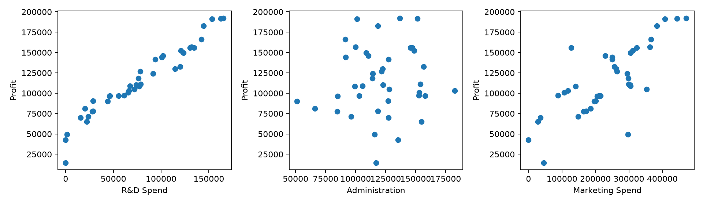
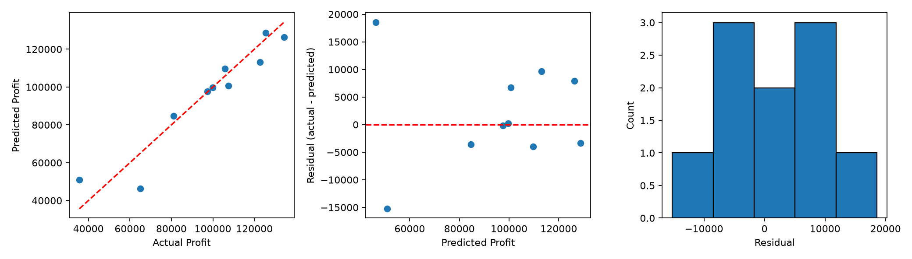

## HW2 洪水預測（5115056023）

- 新版互動成品：https://simon-1224.github.io/AIOT_DOINCLASS/hw2/
- 中文分析報告（不含私人對話）：https://simon-1224.github.io/AIOT_DOINCLASS/hw2/report.pdf
- 主程式、Notebook、資料來源與流程：hw2_flood/README.md
- 資料為50,000筆、20特徵；完整模型接近確定線性生成公式，不能解讀為真實洪災預測能力。
- NotebookLM摘要已由學生提供；完整GPT對話PDF仍待補入本機繳交包。
- 下方保留原本50 Startups作業，舊網站首頁不變。

# 50 Startups 互動作業

網站：https://Simon-1224.github.io/AIOT_DOINCLASS/

執行方式：python -m pip install -r requirements.txt，接著 python main.py。

main.py 會重新產生 dashboard.html；更新 Pages 時將它複製至 docs/index.html 並推送。

網頁以 Python scikit-learn 訓練模型匯出係數；GitHub Pages 提供靜態互動介面，不在伺服器執行 Python。

# 50 Startups：CRISP-DM 多元線性迴歸分析

## 1. 商業理解

目標：使用研發費用、行政費用、行銷費用及州別預測 Profit，協助進行初步情境估算。這是監督式迴歸問題。事先以優於訓練集平均值基準的 MAE、RMSE 作為教學驗收條件；實際業務容許誤差尚未提供。資料金額單位、期間與抽樣方式未經驗證，不將其視為真實投資依據。

## 2. 資料理解

資料為常見 50 Startups 教學 CSV，共五欄。因未提供 Kaggle 檔案，此次使用公開 GitHub 鏡像；不能保證與特定 Kaggle 版本完全相同。先檢查結構與品質，探索關聯則只使用訓練集，避免測試資訊影響建模。保留原始零值及極端值，不任意刪除。

## 3. 資料準備

三個連續變數保留原尺度，方便解釋係數；普通最小平方法不強制標準化。State 使用 one-hot encoding，drop='first' 以一個州作基準。缺值處理與編碼都放在 Pipeline，僅於各訓練折學習。未知州別預設拒絕，避免默默當作基準州。

## 4. 建立模型

模型形式：Profit = 截距 + 三項費用的線性項 + 州別虛擬變數項。使用 sklearn LinearRegression 最小化殘差平方和。設定固定種子、保留 40 筆訓練及 10 筆測試；在訓練資料內做五折交叉驗證，不依測試分數選特徵或刪除異常值。

## 5. 模型評估

MAE 是絕對誤差平均，RMSE 對大誤差更敏感，兩者均與 Profit 同單位；R² 衡量相對平均值預測的變異解釋程度，可以為負。測試集只評估一次。殘差圖用於觀察曲線、漏斗與極端誤差，並非正式證明常態性、獨立性或等變異成立。樣本僅 50 筆，單次切分結果可能不穩定。

## 6. 部署與維護

提供本機 Pipeline 模型與單筆預測示範，尚未上線。評估模型使用 40 筆訓練，其測試分數不可套用到後續全資料重訓模型。另以 50 筆重訓教學部署版，沒有額外未見資料可驗證。實務需驗證輸入單位、範圍與州別，累積新樣本並監控 MAE、資料漂移及定期再訓練。係數表示控制其他欄位後的條件關聯，並不代表增加費用就會因果性提高獲利；費用間共線性也會影響係數穩定性。

## 實際執行結果

```text
                           MSE           MAE          RMSE        R2
LinearRegression  8.201036e+07   6961.477813   9055.957323  0.898727
MeanBaseline      1.140865e+09  25295.290200  33776.691540 -0.408837
```

訓練集五折交叉驗證（平均 ± 樣本標準差）：

- MAE: 7,425.8815 ± 1,977.0158
- RMSE: 9,550.6761 ± 3,282.6850
- R2: 0.9340 ± 0.0361

測試集優於平均值基準（MAE、RMSE）：True。僅屬教學驗收，正式上線仍需業務誤差門檻及外部驗證。

40 筆訓練模型截距：54028.039593645815

```text
                 feature  coefficient
      numeric__R&D Spend     0.805630
 numeric__Administration    -0.068788
numeric__Marketing Spend     0.029855
    state__State_Florida   938.793006
   state__State_New York     6.987760
```

研發費用係數約 0.8056；係數不可直接比較重要性，且不能作因果推論。





資料來源：[公開 CSV 鏡像](https://raw.githubusercontent.com/SantiagoMorenoV/50-Startups-Multiple-Reg/main/50_Startups.csv)；[Kaggle 教學頁](https://www.kaggle.com/code/amrut11/multiple-linear-regression-on-50-startups-dataset)。SHA-256：`722e650044afa9b7c2c54fe690245b6cd64b684c6c6e2ac3e1b7201fb52416c8`。


